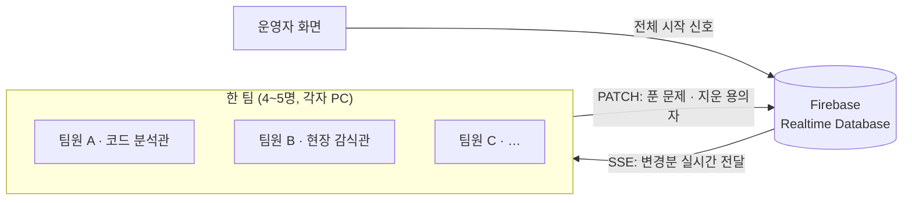

# 🍫 1반 간식 실종 사건

> SSAFY 1반 싸피데이 행사용 **팀 대항 협동 방탈출 웹 게임**
> 4~5명이 서로 다른 역할을 맡아, 각자의 화면에 흩어진 단서를 주고받으며 45분 안에 범인을 찾는 게임


| 🎮 플레이 데모 | 📊 행사 결과 리포트 | 📑 발표 자료 |
|---|---|---|
| [바로 플레이하기](https://hundredtweety.github.io/ssafy-snack-escape/) | [결과 리포트 보기](https://hundredtweety.github.io/ssafy-snack-escape/report.html) | [게임 설명 슬라이드 (PDF)](docs/slides.pdf) |

> 데모 접속 방법: 팀 코드 `CHOCO-17` 입력 → 이름·역할 선택 → 「우리 팀만 지금 시작하기」. 혼자서도 끝까지 플레이할 수 있어요.

<br>

## 📌 프로젝트 개요

| 항목 | 내용 |
|---|---|
| 행사 | 2026.11.09 SSAFY 1반 싸피데이 |
| 참여 | 5팀 21명 · **5팀 모두 제한 시간 45분 안에 사건 해결** |
| 형태 | 설치 없이 크롬에서 바로 실행되는 단일 HTML 웹 게임 + 팀 실시간 동기화 |
| 규모 | 장소 5곳 × 역할 5개, 문제 27개 |

<br>

## 🛠 기술 스택


- **Vanilla JS**: 프레임워크·빌드 도구 없이 구현 (행사 당일 누구나 파일 하나로 실행)
- **Firebase Realtime Database**: REST API + Server-Sent Events로 팀원 화면 동기화
- **Canvas API**: 퍼즐 이미지 합성

<br>

## 🙋 내 역할

- **협동 규칙 설계**: 다른 역할의 화면 정보가 있어야 풀리는 문제 구조, 4·5인 팀 모두 1인당 5문제가 되는 역할 구성
- **시나리오 구성**: 다섯 장소에 걸친 단서 흐름과 「범인은 명단 밖에 있다」 반전 엔딩
- **행사 운영**: 5팀 21명 대상 실시간 진행
- **AI 협업**: 구현은 AI 코딩 도구(Claude)에 맡기고, 플레이 테스트로 문제 3건 발견 → 재현 화면·피드백 전달 → 수정 결과 직접 검증
- **개인정보 판단**: 행사 후 데이터 백업, 공개 전 실명 데이터 분리와 가명 처리 결정

<br>

## ✨ 주요 기능

### 1. 역할 기반 협동 퍼즐

- 장소 5곳(301호 · 간식 선반 · 라운지 · 창가 · 302호) × 역할 5개(코드 분석관 · 현장 감식관 · 기록 분석관 · 탐문 수사관 · 감시 분석관)
- 일부 문제는 필요한 정보가 **다른 역할의 화면**에 있어서, 팀원끼리 말로 주고받아야 풀림
- 팀 인원(4명/5명)과 관계없이 **1인당 5문제**가 되도록 역할 수 조정
- 문제 유형: Python 코드 읽기, SQL, BFS 최단 경로, 비트 연산, 구멍 카드 회전, 밀기 퍼즐, 모스 부호 등


### 2. 팀 실시간 공유

- 한 명이 문제를 풀거나 용의자를 지우면 팀 전원 화면에 즉시 반영
- 현황판(누가 무엇을 풀었는지) · 용의자 보드 · 단서 수첩
- 연결이 끊기면 자동으로 **오프라인 모드** 전환 → 4자리 증거 코드를 말로 전달해 계속 진행

### 3. 최종 추리와 기록

- 다섯 장소의 단서가 모두 열리면 최종 추리 → 반전 → 범인 지목
- 최종 기록 = 실제 소요 시간 + 힌트 1개당 2분 + 오답 지목 1회당 1분
- 엔딩 화면의 인증 코드로 운영자가 기록 위조 여부 확인


<br>

## 🏗 시스템 구조



- **오프라인 대비**: 연결이 끊기면 `localStorage` 저장 + 4자리 증거 코드를 말로 전달하는 모드로 자동 전환
- **단방향 렌더링**: 상태(`ui` 개인 상태 / `T` 팀 공유 상태) 변경 → `render()`로 화면 재생성
- **이벤트 위임**: 모든 버튼에 `data-act` 속성 → `document` 클릭 리스너 하나에서 처리
- **쓰기 순서 보장**: Promise 체인으로 연속 클릭 시에도 요청 순서 유지, 실패 시 1회 재시도
- **정답 보호**: 정답 원문 대신 salt + FNV-1a 해시만 저장, 입력값 정규화(공백·문장부호·단위 제거) 후 비교

<br>

## 🔥 트러블슈팅

> 문제 발견과 수정 방향 결정은 직접 했고, 원인 분석과 수정은 Claude와 함께 진행했어요.

### 1. 퍼즐 화면 레이아웃 붕괴

- **문제**: 창가 퍼즐의 유리창 판이 사라지고 글자가 아래 버튼 위로 쏟아짐
- **원인**: 부모 그리드의 첫 열이 `auto`(내용 크기)인데, 유리창 너비가 `min(300px, 100%)`(부모 크기 기준)라 서로를 기다리는 순환 참조 → 브라우저가 너비 0으로 계산
- **해결**: `width: 300px; max-width: 100%`로 크기를 먼저 확정하고, 좁은 화면에서만 줄어들게 변경
- **결과**: 300×300 판 복원, 카드를 네 번 돌렸을 때 구멍과 글자 위치가 정확히 일치하는지 확인

### 2. 퍼즐을 풀지 않아도 정답이 보이는 문제

- **문제**: 9조각 밀기 퍼즐에서, 섞인 상태인데도 가운데 조각 하나에 비밀번호 4자리가 그대로 보임
- **원인**: Canvas로 그린 포스트잇이 3×3 격자 중 한 칸 안에 통째로 들어가 있었음
- **해결**: 포스트잇을 네 조각이 만나는 꼭짓점으로 옮기고, 숫자의 아래 3/4이 **완성 전까지 빈칸으로 남는 조각**에 들어가도록 좌표 재설계
- **결과**: 완성 전에는 숫자 판독 불가, 완성하면 또렷하게 보임

### 3. 플레이 테스트 피드백 반영

- **문제**: "배치도 보고 → 보드로 이동해서 → 클릭" 흐름이 번거롭다는 피드백
- **해결**: 좌석 배치도의 이름에 용의자 보드와 같은 `data-act="sus"` 액션을 연결 → 이벤트 위임 구조 덕분에 처리 코드 추가 없이 반영
- **결과**: 배치도에서 바로 지우기/되살리기 가능, 팀 전원에게 동일하게 동기화

### 4. 공개용 개인정보 처리

- **문제**: 게임 데이터와 결과에 반 친구 실명 25명이 79곳에 포함
- **해결**: 실명 → 가명 일괄 치환(이름 기반 정답 판정이 깨지지 않는지 확인), 결과 리포트는 데이터 자체를 가명으로 생성, Firebase 주소 제거
- **결과**: 공개 파일 전체 자동 검사에서 실명·이메일·DB 주소 0건

<br>

## 📊 행사 결과

| 순위 | 팀 | 실제 소요 | 힌트 | 오답 지목 | 최종 기록 |
|---|---|---|---|---|---|
| 1 | 2팀 | 20:13 | 1개 | 1회 | **23:13** |
| 2 | 3팀 | 24:50 | 1개 | 1회 | 27:50 |
| 3 | 5팀 | 24:11 | 4개 | 0회 | 32:11 |
| 4 | 1팀 | 30:37 | 1개 | 0회 | 32:37 |
| 5 | 4팀 | 27:07 | 4개 | 1회 | 36:07 |

- 가장 많은 팀이 힌트를 연 문제: 라운지 「모니터 아래 포스트잇」 (3팀)
- 팀별 타임라인과 힌트 통계: [결과 리포트](https://hundredtweety.github.io/ssafy-snack-escape/report.html)


<br>

## 📁 파일 구성

```
ssafy-snack-escape/
├── index.html            # 게임 (오프라인 데모)
├── report.html           # 행사 결과 리포트
├── slides.html           # 설명 슬라이드 인터랙티브 버전 (←/→, F 전체 화면, N 발표자 노트)
└── docs/
    ├── slides.pdf        # 설명 슬라이드 PDF
    ├── code-study-guide.html  # 코드 구조 학습 가이드
    └── *.jpg, *.webp     # 표지, 포스터, 스크린샷
```

<br>

## 참고

- 게임과 리포트에 나오는 **사람 이름은 모두 가명**이에요. 기록과 시각은 실제 행사 데이터 그대로예요.
- 2반 학생(김싸피·이싸피 등)과 사건 내용은 게임을 위해 지어낸 이야기예요.
