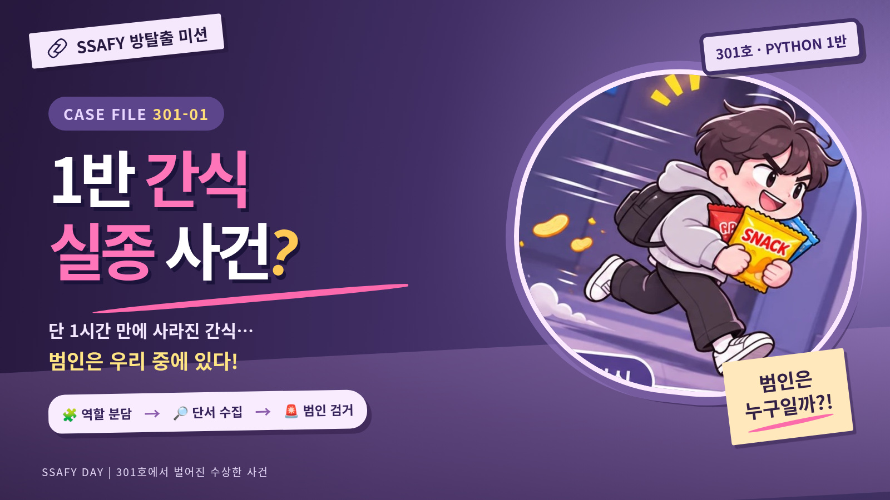
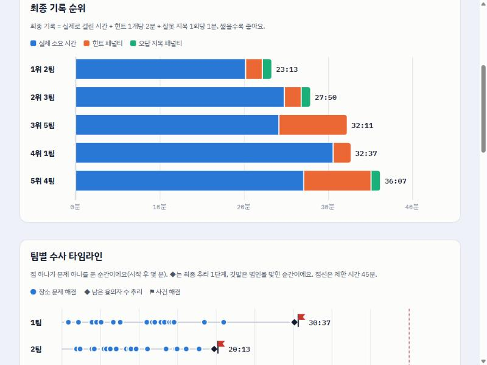
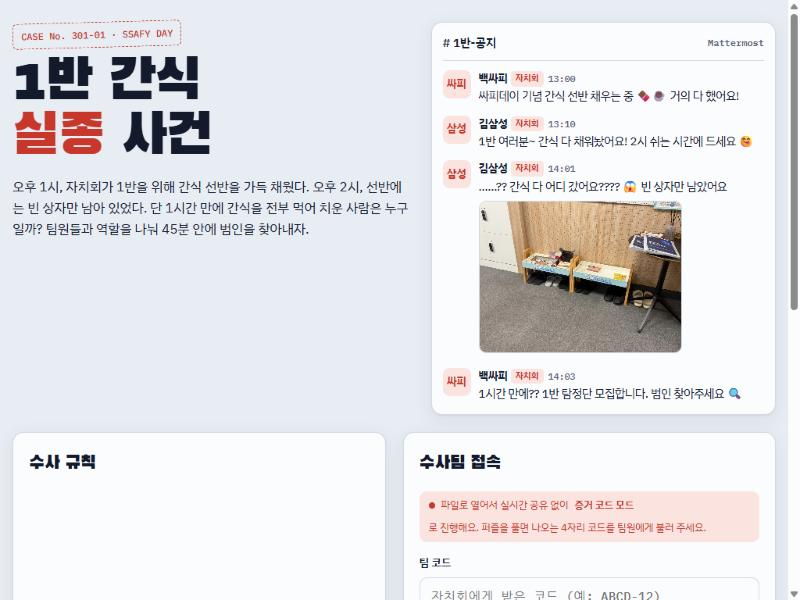
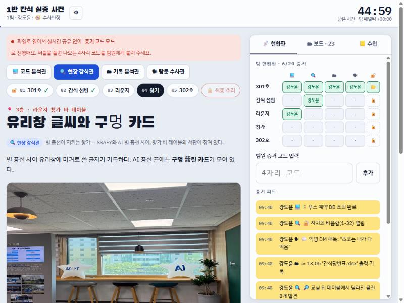

# 🍫 1반 간식 실종 사건

SSAFY 1반 싸피데이를 위해 만든 **팀 대항 협동 방탈출 웹 게임**이에요.
4~5명이 한 팀이 되어 각자 다른 역할을 맡고, 서로의 화면에 있는 단서를 주고받으며 45분 안에 간식을 먹은 범인을 찾아요.

> **발표 자료:** [게임 설명 슬라이드 (PDF, 11쪽)](docs/slides.pdf)
>
> **바로 해 보기:** [hundredtweety.github.io/ssafy-snack-escape](https://hundredtweety.github.io/ssafy-snack-escape/)에 접속하거나, `index.html`을 내려받아 크롬으로 여세요.
> 팀 코드 `CHOCO-17`을 넣고 이름과 역할을 고른 뒤 「우리 팀만 지금 시작하기」를 누르면 혼자서도 끝까지 플레이할 수 있어요.

## 행사 결과 (2026년 11월 9일)

5팀 21명이 참여했고, **5팀 모두 제한 시간 45분 안에 범인을 찾았어요.**

| 순위 | 팀 | 실제 소요 | 힌트 | 오답 지목 | 최종 기록 |
|---|---|---|---|---|---|
| 1 | 2팀 | 20:13 | 1개 | 1회 | **23:13** |
| 2 | 3팀 | 24:50 | 1개 | 1회 | 27:50 |
| 3 | 5팀 | 24:11 | 4개 | 0회 | 32:11 |
| 4 | 1팀 | 30:37 | 1개 | 0회 | 32:37 |
| 5 | 4팀 | 27:07 | 4개 | 1회 | 36:07 |

최종 기록 = 실제 소요 + 힌트 1개당 2분 + 잘못 지목 1회당 1분.
팀별 타임라인과 힌트 통계는 [결과 리포트](report.html)에서 볼 수 있어요.

## 게임 구조

- **장소 5곳 × 역할별 문제**: 301호, 간식 선반, 라운지, 창가, 302호. 한 장소의 모든 역할 문제가 풀리면 그 장소의 단서가 팀 전체에 열려요.
- **역할 5개**: 코드 분석관(Python·SQL·BFS), 현장 감식관(사진 관찰·퍼즐), 기록 분석관(로그·표), 탐문 수사관(증언·암호), 감시 분석관(5명 팀 전용). 팀 인원과 관계없이 한 사람당 5문제예요.
- **협동 설계**: 어떤 문제는 필요한 정보가 다른 역할의 화면에 있어서, 말로 불러 주지 않으면 풀 수 없어요.
- **최종 추리**: 단서로 용의자 보드를 정리하면 반전이 열리고, 범인의 이름을 맞히면 사건이 끝나요.

## 기술 포인트

| 주제 | 구현 |
|---|---|
| 실행 환경 | 프레임워크·빌드 없이 **HTML 파일 하나**. 설치 없이 크롬에서 바로 실행 |
| 화면 구조 | 상태 객체(`ui`, `T`) → `render()`로 화면 전체를 다시 그리는 단방향 흐름, `data-act` 하나로 모든 클릭을 처리하는 이벤트 위임 |
| 실시간 협업 | Firebase Realtime Database REST API + Server-Sent Events(`EventSource`)로 팀원 화면 동기화, Promise 체인으로 쓰기 순서 보장 |
| 장애 대비 | 연결이 끊기면 `localStorage` 저장 + 4자리 증거 코드를 말로 전달하는 오프라인 모드로 자동 전환 (이 저장소의 데모가 이 모드예요) |
| 정답 보호 | 정답 대신 salt를 붙인 FNV-1a 해시만 저장, 입력값 정규화 후 비교 |
| 퍼즐 | 2차원 배열 90° 회전(구멍 카드), 항상 풀리는 밀기 퍼즐 섞기(빈칸 랜덤 워크), Canvas 이미지 합성, 비트 연산·BFS·SQL 문제 |
| 화면 | CSS Grid 반응형 레이아웃, CSS 변수 기반 다크 모드 |

### 운영 중 고친 것

- 창가 퍼즐의 유리창이 너비 0으로 사라져 글자가 버튼 위로 쏟아지던 버그 (CSS Grid `auto` 열과 퍼센트 너비의 순환 참조)
- 사진 조각 퍼즐을 풀지 않아도 비밀번호가 한 조각에 다 보이던 문제 (포스트잇을 네 조각 경계에 걸치게 다시 배치)
- 플레이어 피드백 반영: 좌석 배치도에서 이름을 눌러 바로 용의자를 지울 수 있게 개선

## 파일 구성

| 파일 | 내용 |
|---|---|
| [`index.html`](index.html) | 게임 (오프라인 데모) |
| [`report.html`](report.html) | 행사 결과 리포트 |
| [`docs/slides.pdf`](docs/slides.pdf) | 시작 전 설명 슬라이드 (PDF, 11쪽) |
| [`slides.html`](slides.html) | 같은 설명 슬라이드의 인터랙티브 버전 (←/→ 이동, F 전체 화면, N 발표자 노트) |
| [`docs/code-study-guide.html`](docs/code-study-guide.html) | 게임 코드를 따라가며 공부하는 가이드 |
| `docs/` | 표지, 포스터, 스크린샷, SQL 문제 이미지 |

## 참고

- 게임과 리포트에 나오는 **사람 이름은 모두 가명**이에요. 기록과 시각은 실제 행사 데이터 그대로예요.
- 2반 학생(김싸피·이싸피 등)과 사건 내용은 게임을 위해 지어낸 이야기예요.
